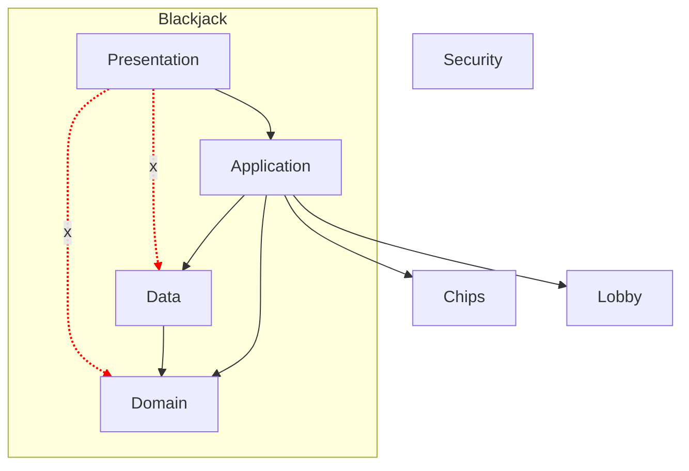

# Oefenopdracht Layered Architecture

Deze startrepository is een bende! Laten we wat gaan opruimen.

Er zijn ook een paar vervelende bugs, maar die gaan we later oplossen.

## Oefening 1: Analyse bestaande situatie

Voordat we te hard aan de slag gaan is het goed om een overzicht te hebben hoe de huidige code nu loopt.

Maak een Class/Package-diagram, waarbij je inzoomt op Blackjack package, en de andere packages puur 'op packageniveau' laat bestaan.
Dat betekent:

* Dat we elke class in Blackjack kunnen zien, en zien wat de dependencies tussen de classes zijn
* Dat we van security/chips/lobby puur een vierkantje voor het package hebben, maar bij de pijl een korte noot waarom die pijl er is

Maak dit diagram in een tool naar keuze (Mermaid, Draw.io, Excalidraw, of gewoon whiteboard of pen & papier). Let erop,
we tekenen de bestaande situatie. En voeg dit plaatje toe aan de repository.

## Oefening 2: Herontwerp

Gegeven dat we nu onze "HU-Standaard" 4-lagenarchitectuur zouden willen:

Wat moet er dan allemaal aangepast worden?
Maak een nieuw diagram waarin je de bestaande classes op de juiste plekken in de gewenste architectuur plaatst.

> Uitzondering: de CSVConverter werkt hier niet mee, zet die gewoon in het data-package. Komen we later dit semester op terug.

## Oefening 3: Implementatie

De laatste stap is het ontwerp implementeren volgens de hierboven (en in de les) beschreven architectuur.
Dit betekent:

* Nieuwe mapjes (packages) aanmaken
* Classes op de juiste plek zetten
* Classes wijzigen, let daarbij op (geen volledige lijst)
    * Dat de BlackjackController de class Game niet meer ziet
        * De Repository moet dus vanuit de Service benaderd worden
        * De vertaling tussen Games en GameResponses moet ook de Service in
    * De Controller de andere componenten niet meer kent. Player enzo moeten dus ook pas vanuit de Service benaderd worden
    * Allerhande static helper-methods uit de controller 'naar beneden' moeten
* (en vast dingen die we nu over het hoofd zien)

Het is mogelijk dat je implementatie afwijkt van je ontwerp, maar voor elke afwijking moet je wel een goede verklaring kunnen geven.