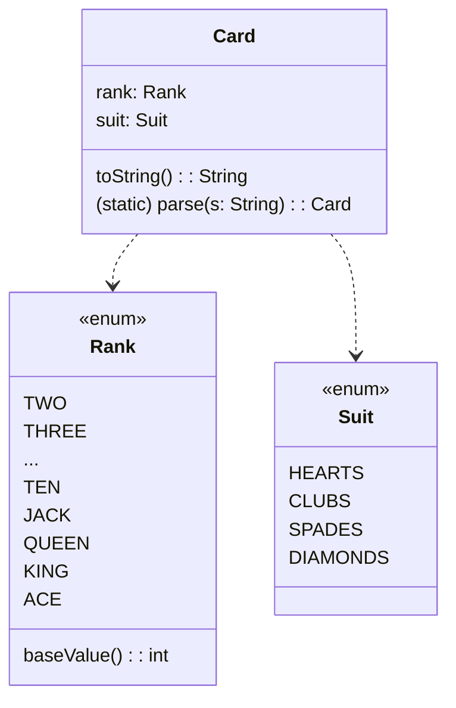
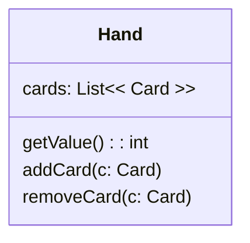

# OOP Oefening

Nu we de lagen wat meer op orde hebben gaan we het volgende probleem oplossen: de code is slecht te begrijpen!

Het thema van de oefening is dat gebruikers melden dat er vanalles mis is met de manier waarop Aas-kaarten (die in Blackjack
1 of 11 punten waard kunnen zijn) behandeld worden. In plaats van alle losse bug-tickets 1-voor-1 tackelen is besloten
groot onderhoud te verrichten!

Voordat we de bugs gaan oplossen, gaan we er eerst voor zorgen dat het oplossen makkelijker wordt.

## Encapsulation

### Oefening 1: Game "Refactoren"

Refactoren is een chique woord voor het veranderen van code-structuur, zonder de functie te wijzigen.
We zien dat de Game class eigenlijk alleen maar Getters, Setters bevat, en dat dus alle combinaties van
waarden mogelijk zijn. Dat is niet heel handig.

1. Pas de constructor aan, zodat je in de GameService makkelijk een game kan maken. De eerste stap is zorgen dat dit voldoende is:
   ```java
    Game game = new Game(player, bet);

    addPlayerCard(game, takeCard(game));
    addPlayerCard(game, takeCard(game));
    addDealerCard(game, takeCard(game));
    addDealerCard(game, takeCard(game));

    if (game.getPlayerValue() == 21) {
        game.setResult("Blackjack");
    }
    
    this.games.save(game);
    return game;
   ```
   Hiervoor zul je ook wat aanpassingen in de Controller & Service moeten doen.
   Verwijder alle setters die je niet meer nodig hebt.
2. De `addPlayerCard`, `addDealerCard` en `game.setResult()` code kan allemaal naar de Game class.
   Kopieer eerst de `takeCard`,`addPlayerCard` en `addDealerCard` methods over, en pas ze aan. Deze hebben geen Cohesion met de Service class
   dus dat zou vrij makkelijk moeten gaan. Vervolgens kan je ook het stukje result-logica de constructor in trekken.
   We kiezen er nu voor eerst de code te dupliceren, omdat er in de service nog wat code is die OOK deze private methods
   gebruikt (namelijk de `hit` en `dealerturn` methods).
3. Uiteraard is dubbele code niet fijn, dus nu is het tijd om de `hit` en `dealerturn` methodes naar `Game` te verplaatsen.
   Kijk echter eens goed waar de `dealerturn` call vandaan komt. `dealerturn` komt uit de 'Stand' actie, dus dat is waarschijnlijk
   een betere naam voor een method op Game.
   Je zult een hele hoop helpertjes uit GameService mee moeten nemen (bijv. `isFinished` en `makeSureGameIsStillRunning`).
   Hopelijk merk je daarbij dat het vooral het verplaatsen van de `Game game` naar `this` is.
4. We kunnen nu ook zoveel mogelijk van de DoubleDown logica naar een nieuwe `doubleDown`
   method op `Game` verplaatsen. Dat is een iets grotere ingreep, maar daarna kun je een volledig potje blackjack
   spelen met **alleen** de `Game` class.

## Abstractions

Als het goed is, hebben we nu zoveel mogelijk van de verdachte code in de Game-class geconcentreerd. Dit betekent dat er minder
Coupling door de applicatie loopt, en dat de Game class een sterkere Cohesion heeft.

Nu gaan we daar gebruik van maken door te proberen de Aas-logica bugs te vatten.

### Oefening 2: Cards

Het gehannes met nummers van kaarten is heel irritant en erg onleesbaar. De berekeningen in `addPlayerCard` en `dealerturn`/`stand`
doen pijn aan de ogen en het brein.

Laten we een nuttige abstractie introduceren: een Card



Deze wijziging heeft best wat voeten in de aarde. Dus zorg er voor dat je commit voordat je start, en zodra je klaar bent.
Schrijf bovenstaande Card class, met de enums. Ter aanvulling:
* `toString()` op `Card` returnt een korte String representatie van de kaart, die je in de DTOs kan gebruiken
* parse draait dat om: die leest die String en maakt er de bijbehorende Card van. Dit hebben we nodig voor de volgende opdracht "Persistentie fixen"
* de `baseValue` van de Rank is de 'simpele waarde' van die kaart, dus:
    * Een getal kaart is z'n getal waard (bijv. de harten-7 is 7 punten waard)
    * Een 'plaatje' is 10 punten waard (bijv. de schoppenboer is 10 punten waard)
    * De aas is altijd 11 punten waard in deze methode.

We kunnen nu de volgende stappen ondernemen:
1. Herschrijf nu de code in GameService, Game (en misschien GameController, als er nog ergens een klein foutje zat)
   om overal de Card class te gebruiken in plaats van de codering van getallen naar kaarten.

2. Je kunt dan in `addPlayerCard` of `stand` direct refereren naar de `baseValue()` van de Rank, ipv. gekke
   modulo berekeningen uitvoeren!

3. Er zijn een aantal gevallen waarin we gekke `if/then/else` of ternary operator `bool ? ifTrue : otherwise`
   logica gebruiken om de aas logica te proberen te fixen. 
   Je kunt hier twee kanten op: Volgens een strikte refactoring-aanpak moet je het gedrag niet veranderen, en moeite stoppen
   om deze vage logica te behouden... Maar mijn advies: verwijder deze gekkigheid voor nu, en gebruik gewoon de baseValue().
   De logica was al buggy, dan kunnen we het op z'n minst duidelijk maken, voordat we het gaan fixen.

#### Persistentie fixen

Helaas moeten we ook wat werk doen om onze persistentie te fixen.
We hadden een CSV-Persister die Ints naar een String vertaalde (komma gescheiden).
Die zullen we nu moeten herschrijven naar eentje die Cards naar een String vertaalt.

Op zich zijn er 100en manieren om dit te doen. Maar mocht je inspiratie willen, dit heb ik gedaan:
Ik zou suggereren om per kaart twee tekens te gebruiken, bijv:
* HQ -> Hartenkoningin
* S8 -> Spades (Schoppen) 8
* CJ -> Jack of Clubs (Klaveren Boer)
* DX -> Diamond (Ruiten) 10, de hack is hier dat we X voor 10 gebruiken

Dit is nu ook hoe de presentatie-laag het oplost. Mijn advies is om hier unit-tests voor te schrijven die bijv. het volgende
testen: `Card.parse(card.toString()).equals(card)` (hiervoor zul je ook `equals`/`hashcode` moeten `@Override`n)

Een andere aanpak is om Jackson te gebruiken en er JSON van te maken/lezen.

### Oefening 3: Je Hands vol met code

De kern van het probleem is dat we niet aan de hand van een enkele kaart de waarde kunnen berekenen.
In de hand [Hartenkoning, Schoppen-7, Klaver-2, Ruitenaas] (20pt) is de Aas 1 punt waard, maar in [Schoppen-7, RuitenAas] (18pt)
is deze 11 punten waard. En je kunt ook meerdere azen in een hand hebben waarvan sommige 1, en een andere 11 punten waard zijn
(dit is waar de bugs wonen).

Kortom, laten we een class `Hand` introduceren, die puur voor ons de waardenberekening oplost:



We kunnen nu de `List<Card> playerCards` en `List<Card> dealerCards` vervangen door de `Hand` class.
Je kunt voor de implementatie van `getValue()` voorlopig nog gewoon de `Rank.baseValue()` gebruiken, dan bestaat
het probleem nog steeds, maar dan is het echt gereduceerd tot 1 klein plekje in de codebase.

De laatste stap is dan in de implementatie van `getValue()` correct rekening houden met meerdere Aas-kaarten. Daar
zou je zelfs Unit-Tests voor kunnen gebruiken... 
(Dit is niet bedoeld als hint, maar als opdracht: schrijf unit-tests voor de Hand class, Azen die 1 zijn, Azen die 11 zijn,
meerdere Azen, etc.)

En dan zijn we er bijna, want het introduceren van die `Hand` class heeft JPA boos gemaakt...

#### Persistentie fixen

Die Hand class moet ook nog de database in... Er zijn hier 2 mogelijkheden, een makkelijke die niet helemaal zuiver is,
en een lelijke die wel helemaal klopt.

Eerst de 'makkelijke', maak er gewoon een `@Entity` van, geef het een `@GeneratedValue` `Long id` en gooi `@OneToOne(cascade = CascadeType.ALL)` op de associatie
van `Game` -> `Hand`. Dat werkt, maar introduceert een nieuwe tabel, en eerlijk gezegd een beetje een onzin-primary-key.
Dit is voor S3 goed genoeg, want het is vooral 'framework-gezeik', maar het kan natuurlijk netter...

De nette manier loopt tegen een probleempje in JPA aan:
Met `@Embedded` op de associatie kun je JPA instrueren om de Cards in de Game op te slaan. Het enige probleem is dat JPA dan
de kolomnaam uitleest uit de Hand-class. Dat betekent dat zowel de spelerkaarten als de dealerkaarten dan de `cards` kolom
in zouden gaan. Eigenlijk zou een `@Embedded` object z'n kolomnaam moeten baseren op de naam van de eigenaar, bijv. `player_cards`,
maar dat is gewoon nooit in JPA geimplementeerd.

Je kunt dit fixen met iets als:
```java
    @AttributeOverride(name="cards", column=@Column(name="player_cards"))
    @Embedded
    private Hand playerCards;
```
Dat heeft precies het juiste gedrag, maar het is wel lelijke code. Want nu moet de Game class weten hoe private fields van de
Hand class eruit zien.

Kortom, dit is zo'n geval dat er geen ideale oplossing is. 
(en er zijn in deze hoek nog een boel andere oplossingen hoor, dus als je zelf een ander idee hebt, deel het met ons!)

### Afsluiting

Dit is niet een volledige reparatie van alles wat hier mis gaat (neem bijv. de resultstatussen als String), maar het
geeft je hopelijk een aantal ideeën:
 
* Hoe kan goed OOP helpen om je minder werk op te leveren? 
* Hoe kunnen gelaagde architecturen je helpen om testbare code op te leveren?

Hopelijk kun je inzien dat het structureren, analyseren en redeneren over code ook in een AI-generated tijdperk van dezelfde
onschatbare waarde zal blijven. Typesnelheid is nooit ons probleem geweest.